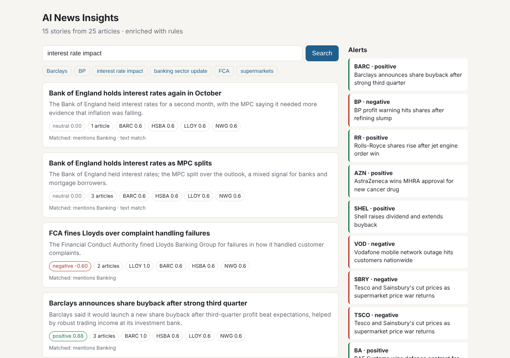
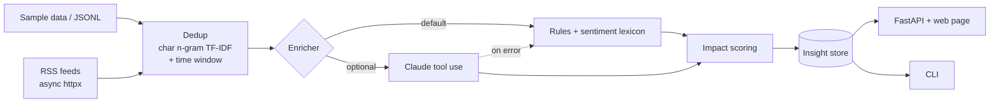

# AI News Insights

[](https://github.com/Prakruthimanjunath20/ai-news-insights/actions/workflows/ci.yml)


Financial news arrives as dozens of near-identical headlines from different outlets.
**AI News Insights** collapses them into single *stories*, works out which UK-listed
companies, sectors and regulators each story is about, scores its market sentiment,
and ranks the stocks most likely to be affected. Everything is served through a typed
FastAPI service with a small web page, a command-line tool and live RSS ingestion.



## What it does

| Stage | How |
| --- | --- |
| **Ingest** | Bundled sample data, any JSON Lines file, or live RSS/Atom feeds fetched concurrently with `httpx` + `asyncio` |
| **Deduplicate** | TF-IDF on character n-grams + cosine similarity, linked only inside a 72-hour window, grouped with union-find |
| **Enrich** | Offline rules (catalogue matching + finance sentiment lexicon) by default, or **Claude** with structured tool-use output and automatic fallback to rules |
| **Impact** | Direct mention → 1.0 confidence, sector link → 0.6, regulator link → 0.5, with the story's sentiment as the expected direction |
| **Query** | Entity-aware search ("Barclays", `LLOY`, "banking sector update", "interest rate impact") blended with text similarity, plus watch-list alerts |



## Quick start

Requires Python 3.11+ and [uv](https://docs.astral.sh/uv/).

```bash
git clone https://github.com/Prakruthimanjunath20/ai-news-insights.git
cd ai-news-insights
uv sync
uv run news-insights serve        # open http://127.0.0.1:8000
```

From the command line:

```bash
uv run news-insights search "interest rate impact"
uv run news-insights alerts --watchlist BP,BARC
uv run news-insights stories --ticker AZN
```

Or with Docker:

```bash
docker build -t ai-news-insights .
docker run -p 8000:8000 ai-news-insights
```

### Using Claude for enrichment (optional)

```bash
uv sync --extra llm
export ANTHROPIC_API_KEY=...
export NEWS_INSIGHTS_ENRICHER=claude          # default: rules
export NEWS_INSIGHTS_MODEL=claude-haiku-5-5   # default shown
uv run news-insights serve
```

Claude is asked to call a single tool whose JSON schema lists the known sectors and
regulators as enums, so the response is always structured. Company names are mapped
back to tickers through the catalogue. If a call fails (network, quota, bad output),
that story is enriched with the offline rules instead and the pipeline carries on.

## API

Interactive docs are at `/docs` when the server is running.

| Method | Path | Description |
| --- | --- | --- |
| GET | `/health` | Article and story counts, active enricher |
| GET | `/stories?ticker=&sentiment=&limit=` | Latest stories, optionally filtered |
| GET | `/stories/{id}` | One story with entities, sentiment and impacted stocks |
| GET | `/search?q=&limit=` | Ranked search with an explanation of each match |
| GET | `/companies` | The tracked company catalogue |
| GET | `/companies/{ticker}/stories` | Stories affecting one company |
| GET | `/alerts?watchlist=BARC,BP` | Strongly positive or negative stories for a watch list |
| POST | `/ingest/rss` | Fetch RSS feeds (body: `{"feeds": [...]}`, optional) and rebuild |

## Configuration

| Variable | Default | Purpose |
| --- | --- | --- |
| `NEWS_INSIGHTS_ENRICHER` | `rules` | `rules` or `claude` |
| `NEWS_INSIGHTS_MODEL` | `claude-haiku-5-5` | Claude model used when the enricher is `claude` |
| `NEWS_INSIGHTS_DATA` | bundled sample | Path to a JSON Lines file of articles to load at start-up |
| `ANTHROPIC_API_KEY` | – | Needed only for the Claude enricher |

## Design notes

- **Why character n-grams for deduplication?** Outlets reword the same event
  ("holds rates" / "held rates", "buyback" / "buy-back"). On the sample data, word
  TF-IDF scored some true duplicates as low as 0.14, while character n-grams keep
  every duplicate at 0.38 or above and every different story at 0.21 or below, so the
  0.30 threshold sits in a clear gap.
- **Why a time window?** "Bank of England holds interest rates" can be a headline
  after every rate-setting meeting, roughly every six weeks. Without the window, September's and October's decisions would merge.
- **Why case-sensitive company matching?** So `BP` is not found in "rose 10 bp" and
  `BT` is not found in lowercase text. Search queries are matched case-insensitively.
- **Why a finance lexicon instead of a generic sentiment model?** Market language
  inverts everyday meaning ("cuts costs" is good, "cuts guidance" is bad), so phrases
  are scored before single words and negators flip the following word.

## Project structure

```text
src/news_insights/
  models.py          Pydantic v2 models shared by every stage
  catalog.py         UK companies, sectors and regulators
  dedup.py           Story clustering
  enrich/            Rules, sentiment lexicon and optional Claude enricher
  impact.py          Impacted-stock scoring
  search.py          Entity-aware search
  pipeline.py        Orchestration, insight store and alerts
  ingest/            JSON Lines loader and async RSS fetcher
  api.py, cli.py     FastAPI service and command-line tool
  static/index.html  Web page (no build step)
  data/              Synthetic sample articles
tests/               pytest suite (28 tests, no network needed)
```

## Development

```bash
uv sync --all-extras
uv run pytest
uv run ruff check . && uv run ruff format --check .
```

GitHub Actions runs the same checks on Python 3.11, 3.12 and 3.13.

## About the sample data

`src/news_insights/data/sample_articles.jsonl` is **synthetic**: 25 invented headlines
about real UK-listed companies, written to exercise deduplication, entity extraction
and sentiment. The outlets ("Sample Wire", "Demo Business Daily", "Example Markets")
and links are fictional. None of it is real news.

## Acknowledgements

The idea was inspired by
[ai-financial-news-engine](https://github.com/shashanksuresh18/ai-financial-news-engine)
by [@shashanksuresh18](https://github.com/shashanksuresh18). This project is an
independent implementation with a UK market focus; it does not reuse that project's code.

## Author

**Prakruthi Manjunath** · [GitHub](https://github.com/Prakruthimanjunath20) ·
[LinkedIn](https://www.linkedin.com/in/prakruthi21)

Licensed under the [MIT License](LICENSE).
